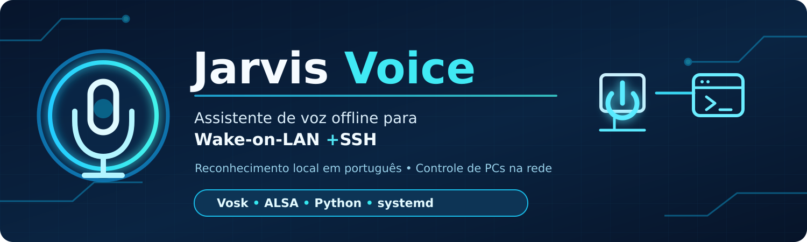
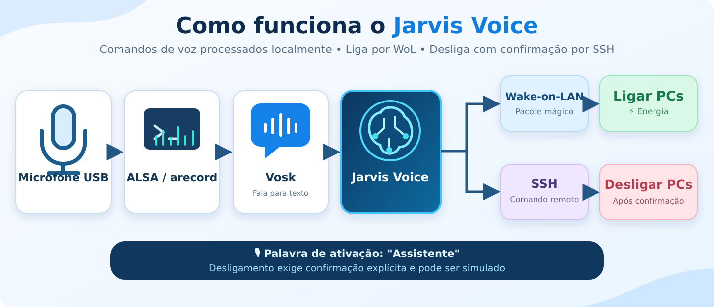

<p align="center">
  
</p>

# 🎙️ Jarvis Voice

<p align="center">
  
  
  
  
</p>

Assistente de voz local em português brasileiro para ligar computadores por **Wake-on-LAN (WoL)** e solicitar desligamento por **SSH**, executado em Debian/Proxmox LXC com microfone USB, ALSA e Vosk.

> **Sobre este repositório:** esta é uma implementação pública de referência, reconstruída a partir dos testes e da lógica documentada do projeto. **Não é uma cópia integral do arquivo atualmente instalado no servidor**, ao qual esta publicação não tem acesso. O serviço que já funciona no laboratório não é modificado por estes arquivos.

## ✨ Funcionalidades

- 🎤 Palavra de ativação **"Assistente"**
- 🗣️ Comandos em português: "Ligar Fusion", "Desligar Fusion", "Ligar Ananuke", "Desligar Ananuke"
- 🔤 Variante fonética "ana no que" para o nome Ananuke
- 🔐 Confirmação para desligamento; no modo real exige a frase completa **"confirmar desligamento"**
- ⏳ Cancelamento, prazo de expiração, fila limitada e descarte de áudio atrasado
- ⚡ Wake-on-LAN por UDP e desligamento remoto via SSH
- 🧪 Simulação por padrão: nenhuma operação de energia ocorre sem configuração explícita
- 🔄 Serviço systemd de exemplo para Debian LXC
- ⚙️ Configuração local separada do código

## 🧠 Arquitetura



<details>
<summary>📐 Ver arquitetura simplificada em texto</summary>


```text
Microfone USB -> ALSA/arecord -> Vosk -> máquina de estados
                                      |
                                      +-> "ligar" -> Wake-on-LAN
                                      |
                                      +-> "desligar" -> confirmação -> SSH
```

</details>

💡 **Nota de integração:** O protótipo original utilizava funções do painel Flask `ligar.casa`. **Esta implementação pública de referência é independente do painel**; o painel existente não precisa ser alterado.

## 🚀 Instalação (Debian 12/13)

Requisitos: Python 3, microfone ALSA acessível pelo usuário de serviço, rede local com WoL habilitado no computador destino, SSH com autenticação por chave e privilégios de desligamento configurados no destino.

```bash
sudo apt update
sudo apt install -y python3 python3-venv alsa-utils
git clone https://github.com/Yagami-Murakami/jarvis-voice.git
cd jarvis-voice
python3 -m venv venv
./venv/bin/pip install -r requirements.txt
cp config.example.json config.json
chmod 600 config.json
```

Baixe separadamente um modelo Vosk para português e configure seu caminho absoluto em `config.json`. O modelo **não é distribuído neste repositório**. Revise também o dispositivo ALSA, MACs, IPs, usuários SSH e nomes de destino.

Valide o microfone com `arecord -l` e `arecord -D plughw:CARD=ME6S,DEV=0 -f S16_LE -r 16000 -c 1 -d 4 teste.wav`, adaptando o dispositivo.

Para um primeiro teste sem ações reais:

```bash
JARVIS_CONFIG="$PWD/config.json" ./venv/bin/python jarvis_voice.py
```

Os arquivos de exemplo contêm **endereços e MACs fictícios**: precisam ser personalizados. Quando validado, habilite explicitamente as variáveis:

```bash
JARVIS_WOL_REAL=1 JARVIS_SSH_REAL=1 \
JARVIS_CONFIG="$PWD/config.json" \
./venv/bin/python jarvis_voice.py
```

⚠️ **Cuidado:** nessa última execução as ações de energia são reais. Salve trabalhos abertos e faça o teste com supervisão. Não interprete um host inacessível como prova de que está desligado.

## ⚙️ Serviço systemd

Consulte `systemd/jarvis-voice.service` e adapte `User`, `WorkingDirectory`, `ExecStart` e `JARVIS_CONFIG`. O exemplo começa em **modo simulado**. Um serviço em produção deve ser ativado somente após validar dispositivo de áudio, SSH, WoL e riscos de falsos positivos.

```bash
sudo cp systemd/jarvis-voice.service /etc/systemd/system/
sudo systemctl daemon-reload
sudo systemctl enable --now jarvis-voice.service
sudo systemctl status jarvis-voice.service
sudo journalctl -u jarvis-voice.service -f
```

## 🔐 Segurança e limitações

- **Reconhecimento de voz não autentica a identidade do falante**. Pessoas próximas, gravações e sons de outros dispositivos podem ser reconhecidos. Evite deixar desligamentos reais habilitados em ambientes públicos.
- O protótipo operacional foi validado no laboratório; **esta versão pública reconstruída ainda precisa de homologação no ambiente real**.
- Não publique `config.json`, chaves SSH, tokens, gravações ou modelos de voz particulares.
- Para o Debian, o comando remoto testado foi `sudo -n /usr/sbin/poweroff`; no Windows, `shutdown /s /t 0`. Configure privilégios mínimos no destino.
- O Vosk pode reconhecer palavras imprecisamente. Por isso, desligamento requer ativação, ordem específica e confirmação específica.
- As flags `JARVIS_WOL_REAL` e `JARVIS_SSH_REAL` vêm desativadas por padrão.

## ✅ Status do laboratório (09/11/2026)

No ambiente original, o Fusion (Windows) e o Ananuke (Debian) foram ligados via WoL e desligados via SSH. O controle por voz foi validado com o microfone USB e iniciado como `jarvis-voice.service` no LXC 110.

## 👨‍💻 Autor

[**Yagami-Murakami**](https://github.com/Yagami-Murakami)
